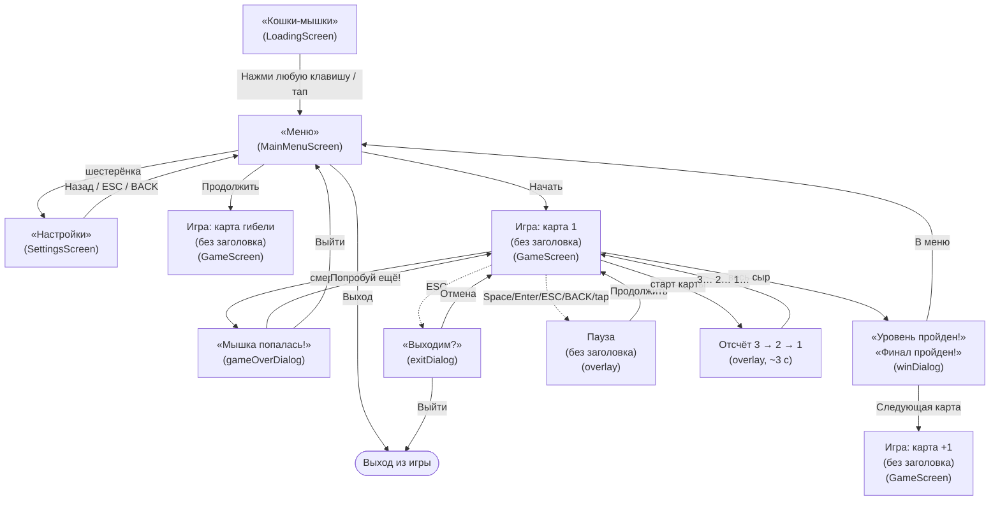

# MENU.md — экраны, меню и переходы

Источник истины для всей навигации игры **CATS AND MOUSES**. Любое изменение меню, кнопок или переходов
сначала описывается здесь, и только потом пишется код. Код генерируется по правилам и таблицам этого файла.

Связанные документы: [GAME.md](GAME.md) (общее описание), [AGENTS.md](AGENTS.md) (правила работы агента).

---

## 1. Карта экранов и переходов

---

## 2. Экраны

| Человеческое имя | Код | Тип |
|---|---|---|
| Загрузка | `LoadingScreen` | экран |
| Меню | `MainMenuScreen` | экран |
| Настройки | `SettingsScreen` | экран |
| Игра | `GameScreen` | экран |
| Отсчёт (3 → 2 → 1) | оверлей в `GameScreen` | оверлей |
| Пауза | оверлей в `GameScreen` | оверлей |
| Мышка попалась! | `gameOverDialog` | оверлей |
| Победа | `winDialog` | оверлей |
| Выходим? | `exitDialog` | оверлей |

---

## 3. Кнопки меню и оверлеев

Заголовки экранов и оверлеев (константы `MenuDefinitions`):

| Экран/оверлей | Заголовок | Константа |
|---|---|---|
| Заставка (`LoadingScreen`) | Кошки-мышки | `TITLE_GAME` |
| Меню (`MainMenuScreen`) | Меню | `TITLE_MENU` |
| Настройки (`SettingsScreen`) | Настройки | `TITLE_SETTINGS` |
| Мышка попалась! (`gameOverDialog`) | Мышка попалась! | `TITLE_GAME_OVER` |
| Победа, обычная карта (`winDialog`) | Уровень пройден! | `TITLE_WIN` |
| Победа, финал (`winDialog`) | Финал пройден! | `TITLE_FINAL` |
| Выходим? (`exitDialog`, ESC) | Выходим? | `TITLE_EXIT` |
| Пауза (оверлей) | без заголовка (только кнопка) | — |

Порядок строк = порядок кнопок сверху вниз.

### 3.0 Загрузка (`LoadingScreen`)
Заголовок: **«Кошки-мышки»** (светлая кремовая заливка + тёмная обводка). Внизу подсказка **«Нажми, чтобы начать»**.
Переход в меню — по **пробелу** или **тапу** (после минимальной задержки 1 c). Версия в правом нижнем углу — мелким шрифтом.
Звучит **музыка меню** — стартует здесь и без разрыва продолжается в меню (см. §5, «Музыка»).

### 3.1 Меню (`MainMenuScreen`)
Заголовок: **«Меню»**. Список кнопок не меняется (не более 3 → влезает всегда).

| Кнопка | Условие показа | Действие |
|---|---|---|
| `Начать` | всегда | сброс прогресса, старт с карты 1 |
| `Продолжить` | есть прогресс (`hasProgress`) | старт с карты, где убили (сохранённый уровень) |
| `Выход` | только Desktop | выход из приложения |

Дополнительно — **иконка-шестерёнка** в правом верхнем углу (вне столбца кнопок):
зона клика **72×72**, отступ **40 px** от верхнего и правого края, подсветка (тинт) при нажатии,
tap/клик → экран **«Настройки»**. Клавиатурной навигацией не управляется.

### 3.2 Мышка попалась! (`gameOverDialog`)
Оформлен **как главное меню**: полноэкранный оверлей `UiMenuOverlay` — фон темы тайлами,
заголовок **«Мышка попалась!»** на том же отступе 40 px, две кнопки по центру с зазором 7 px.
Без тёмной панели и затемнения.

Показывается только когда запас жизней исчерпан (`lives == 0`). Если у мыши есть запас,
поимка жизнью не завершает игру: жизнь тратится, мышь телепортируется в самую далёкую от котов
клетку и получает неуязвимость (`Constants.INVULN_TIME`); экран не появляется.

Активная кнопка — по умолчанию **верхняя** («Попробуй ещё!»); переключение ↑/↓,
активация — **Space/Enter**, а также tap/клик.

| Кнопка | Действие |
|---|---|
| `Попробуй ещё!` | перезапуск той же карты (жизни сбрасываются к `START_LIVES = 1`) |
| `Выйти` | в главное меню |

### 3.3 Победа (`winDialog`)
Оформлен **как главное меню**: полноэкранный оверлей `UiMenuOverlay` — фон темы тайлами,
заголовок («Уровень пройден!» / «Финал пройден!») на отступе 40 px, кнопки по центру с зазором 7 px.
Активная кнопка по умолчанию — верхняя; переключение ↑/↓, активация Space/Enter/tap/клик.

| Кнопка | Условие показа | Действие |
|---|---|---|
| `Следующая карта` | не финальная карта | следующая карта |
| `В меню` | финальная карта | сброс прогресса, в главное меню |

### 3.4 Выходим? (`exitDialog`, по ESC)
Заголовок: **«Выходим?»**

| Кнопка | Действие |
|---|---|
| `Отмена` | вернуться в игру |
| `Выйти` | **выход из игры** |

### 3.5 Пауза (оверлей)
Заголовок отсутствует; единственная кнопка:
| Кнопка | Действие |
|---|---|
| `Продолжить` | снять паузу |

Пауза ставится/снимается по **Space, Enter, ESC, Android BACK**, а также tap/кликом по кнопке.

### 3.6 Отсчёт (оверлей, ~3 c)
Показывается при **каждом старте карты** (новая игра, «Попробуй ещё!», «Следующая карта») до начала
движения. По центру экрана — крупная цифра **3 → 2 → 1** (по 1 c) с наплывом и затуханием, фон
затемнён синхронно с цифрой. Во время отсчёта мышь и коты **заморожены**, сыр не собирается, а
**Space/ESC/BACK/тап игнорируются** (пауза и меню недоступны — игра ещё не началась). Ввод
направления запоминается и срабатывает сразу после отсчёта. Отключён в `--ai-mode`, playtest
редактора и по dev-флагу `--no-countdown`.

### 3.7 Настройки (`SettingsScreen`)
Заголовок: **«Настройки»** (отступ 40 px), фон — системная тема тайлами.

Два **ползунка** (значение 0…100, шаг **10**, 0 = тишина), подпись с процентом, и кнопка «Назад»:

| Строка | Что настраивает | Дефолт |
|---|---|---|
| `Музыка` (напр. `Музыка 80%`) | громкость всей музыки | 80% |
| `Звуки` (напр. `Звуки 80%`) | громкость всех SFX | 80% |
| `Назад` | вернуться в главное меню | — |

Навигация ↑/↓ — фокус по строкам; ←/→ (или tap/drag по дорожке) — изменение значения на шаг.
Активация `Назад` — Space/Enter/tap/клик. **Android BACK** и **Desktop ESC** — «Назад».
Изменения применяются и сохраняются сразу.

---

## 4. Сводная таблица переходов

| Событие | Откуда | Куда | Что сохраняется |
|---|---|---|---|
| «Начать» | Меню | Игра, карта 1 | `ProgressStore.clear()` |
| «Продолжить» | Меню | Игра, сохранённый уровень | — |
| «Выход» | Меню | выход из приложения | — |
| Шестерёнка | Меню | Настройки | — |
| «Назад» / ESC / BACK | Настройки | Меню | — |
| Поимка с запасом жизни | Игра | Игра (телепорт + неуязвимость, жизнь −1) | — |
| Смерть (жизни = 0) | Игра | Мышка попалась! | `saveOnDeath(level, score)` (жизни → `START_LIVES`) |
| «Попробуй ещё!» | Мышка попалась! | та же карта, жизни = `START_LIVES` | — |
| «Выйти» | Мышка попалась! | Меню | — |
| Победа (не финал) | Игра | Победа | `saveOnAdvance(level + 1, score, lives)` |
| «Следующая карта» | Победа | карта +1 (жизни переносятся) | `saveOnAdvance(level + 1, score, lives)` |
| «В меню» (финал) | Победа | Меню | `ProgressStore.clear()` |
| ESC | Игра | Выходим? | — |
| «Отмена» | Выходим? | Игра | — |
| «Выйти» | Выходим? | выход из приложения | — |
| Space/Enter/ESC/BACK/tap | Игра | Пауза | — |
| «Продолжить» | Пауза | Игра | — |

---

## 5. Правила UI

- Кнопки — `UiButton`: ширина `Constants.BUTTON_WIDTH` (360), высота `Constants.BUTTON_HEIGHT` (170),
  текстуры `ui/button.png` (обычная) и `ui/button_pressed.png` (нажатая).
- **Активная кнопка** (под фокусом) приподнята **влево-вверх на 10 px** (`UiButton.LIFT`) и подсвечена
  (`button_pressed.png`); при нажатии (тач/клик или удержание Space/Enter) возвращается на место с
  обычной текстурой (`button_normal.png`) — эффект отжима. Область нажатия (`bounds`) не смещается;
  сдвиг мгновенный. Относится ко всем меню и оверлеям (главное меню, Game Over, Победа, Выходим?, пауза).
- Шрифт кнопок — BoldPixels, `Constants.FONT_SIZE_BUTTON` (32); заголовки — `FONT_SIZE_OVERLAY`/`FONT_SIZE_TITLE`.
- Цвета — `FONT_COLOR_TEXT` (кремовый), `FONT_COLOR_ACCENT` (акцент нажатия).
- Оверлеи — `UiDialog`: затемнение экрана 60 %, панель по центру, заголовок сверху, кнопки столбцом.
- Шаг между кнопками в диалогах — 90 px; в главном меню — 7 px (поочерёдно уменьшен на 30 % и 50 % от 20 px).
- Заголовок экрана — отступ **40 px** от верхнего края (одинаково у заставки и главного меню).
- **Счёт и рекорд не отображаются** (временно скрыты из HUD и меню).
- **Тема фона**: заставка, главное меню и все оверлеи используют **системную** тему (`system` в `assets/themes/themes.json`, сейчас `grass`); лабиринт — тему текущего мира (`assets/maps/<мир>/theme.json`).
- Версия в правом нижнем углу (**заставка, меню и HUD**) — мелким шрифтом (`FONT_SIZE_HUD`, 16) и с **режимом запуска**: `v<версия>(d|r|i|a)`, где
  `d` — dev (`lwjgl3:run`), `r` — дистрибутив (`runDist`/`desktop-run.bat`), `i` — конфигурация IDEA «Run Idea»,
  `a` — Android.
- **Ползунок (`UiSlider`)**: дорожка `ui/slider_track.png` (тянется по X), заполненная часть — та же
  текстура с акцентным тинтом, насечки (11 шт.) — `ShapeRenderer`, ручка `ui/slider_knob.png` 1:1.
  Шаг 10, диапазон 0…100. Процент показывается в подписи строки.
- **Иконка-шестерёнка**: `ui/settings_gear.png` (72×72), правый верхний угол меню; подсветка тинтом при нажатии.
- **Музыка**: заставка, меню и Настройки — один общий луп (стартует на заставке, не перезапускается при
  переходе между экранами); геймплей — свой луп; на паузе — приглушение (ducking); при Победе/поражении —
  стоп + стингер. Общая громкость — ползунок «Музыка» (0 = тишина).
- **SFX**: клики кнопок/шестерёнки, шаг ползунка «Звуки», сыр, сердечко, потеря жизни, телепорт, тик отсчёта,
  стингеры win/lose. Громкость — ползунок «Звуки».

---

## 6. Прогресс (`ProgressStore`)

Все обращения к `Preferences` идут только через `ProgressStore` (ключи — `Constants.KEY_*`).

| Метод | Назначение |
|---|---|
| `hasProgress()` | есть ли сохранённый прогресс |
| `savedLevel()` | индекс сохранённого уровня (карты) |
| `savedScore()` | сохранённый счёт |
| `savedLives()` | сохранённый запас жизней (для «Продолжить») |
| `bestScore()` | лучший счёт |
| `saveOnDeath(level, score)` | сохранить уровень гибели и счёт, жизни → `START_LIVES`, `hasProgress = true` |
| `saveOnAdvance(level, score, lives)` | сохранить продвижение на следующий уровень и накопленные жизни |
| `musicVolume()` / `sfxVolume()` | громкость музыки / звуков, 0…100 (дефолт 80) |
| `setMusicVolume(v)` / `setSfxVolume(v)` | сохранить громкость (клэмп 0…100, `flush`) |
| `clear()` | сбросить прогресс (`hasProgress = false`, жизни → `START_LIVES`) |

Индекс уровня — 0-based в списке `Constants.MAP_FILES` (`1/1`, `1/2`, `1/3`, `1/4`, `final`).

---

## 7. Соответствие коду

| Сущность из MENU.md | Код |
|---|---|
| Переходы между экранами | `ScreenRouter` |
| Кнопки/надписи/порядок | `MenuDefinitions` |
| Прогресс в Preferences | `ProgressStore` |
| Список карт | `Constants.MAP_FILES` |
| Создание экранов, `setScreen` | `MainGame` |
| Отрисовка и локальные оверлеи | `MainMenuScreen`, `GameScreen`, `SettingsScreen` |
| Звук (музыка/SFX) | `AudioManager` |

---

## 8. История изменений меню

- **1.1.0** — экран «Настройки» (`SettingsScreen`): ползунки «Музыка»/«Звуки» (шаг 10, дефолт 80%) и «Назад»;
  вход — иконка-шестерёнка в правом верхнем углу меню. Музыка: общий луп заставки/меню (продолжается в
  Настройках), геймплейный луп, ducking на паузе, стингеры win/lose; SFX по игре и меню (`AudioManager`).
- **1.0.56** — добавлен предыгровой оверлей «Отсчёт» (`3 → 2 → 1`, ~3 c): игра стартует не сразу,
  мышь/коты заморожены, пауза/меню во время отсчёта недоступны. Отключено в AI-режиме, playtest
  редактора и по `--no-countdown`.
- **1.0.54** — жизни: сердечки дают +1 (до 7), поимка с запасом не открывает «Мышка попалась!»
  (телепорт + неуязвимость), запас переносится между картами и хранится в прогрессе; «Продолжить»
  восстанавливает жизни, «Попробуй ещё!» начинает с 1. HUD — 7 сердечек, неактивные серые (`heart_grey`).
- **1.0.50** — подсказка на заставке «Нажми пробел» → нейтральная **«Нажми, чтобы начать»** (устраивает
  и клавиатуру, и тач). Логика перехода в меню не менялась.
- **1.0.48** — активная кнопка визуально приподнята влево-вверх на 10 px (подсветка `button_pressed`);
  при нажатии отжимается на место с обычной текстурой. `UiButton.isFocused` отделён от `isPressed`.
- **1.0.47** — введена системная тема (`system` = `grass`) для заставки, меню и оверлеев;
  тема лабиринта берётся из `theme.json` мира. Навигация и кнопки не менялись.
- **1.0.44** — документ создан. Меню: «Играть» → «Начать». Game Over: заголовок «Мышка попалась!»,
  кнопки «Попробуй ещё!» / «Выйти». ESC-меню: «Отмена» / «Выйти» (выход из игры). «Продолжить» продолжает
  с карты гибели. Счёт и рекорд скрыты. Все оверлеи (Game Over, Победа, Выходим?) — в стиле главного меню
  (`UiMenuOverlay`), заголовки сведены в таблицу (§3).
