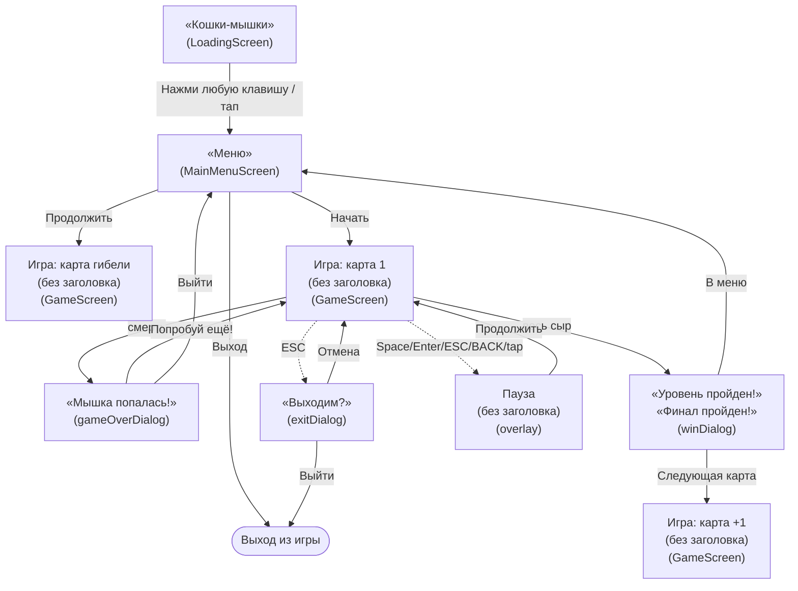

# MENU.md — экраны, меню и переходы

Источник истины для всей навигации игры **CATS AND MOUSES**. Любое изменение меню, кнопок или переходов
сначала описывается здесь, и только потом пишется код. Код генерируется по правилам и таблицам этого файла.

Связанные документы: [GAME.md](GAME.md) (общее описание), [AGENTS.md](AGENTS.md) (правила работы агента).

---

## 1. Карта экранов и переходов

---

## 2. Экраны

| Человеческое имя | Код | Тип |
|---|---|---|
| Загрузка | `LoadingScreen` | экран |
| Меню | `MainMenuScreen` | экран |
| Игра | `GameScreen` | экран |
| Пауза | оверлей в `GameScreen` | оверлей |
| Мышка попалась! | `gameOverDialog` | оверлей |
| Победа | `winDialog` | оверлей |
| Выходим? | `exitDialog` | оверлей |

---

## 3. Кнопки меню и оверлеев

Заголовки экранов и оверлеев (константы `MenuDefinitions`):

| Экран/оверлей | Заголовок | Константа |
|---|---|---|
| Заставка (`LoadingScreen`) | Кошки-мышки | `TITLE_GAME` |
| Меню (`MainMenuScreen`) | Меню | `TITLE_MENU` |
| Мышка попалась! (`gameOverDialog`) | Мышка попалась! | `TITLE_GAME_OVER` |
| Победа, обычная карта (`winDialog`) | Уровень пройден! | `TITLE_WIN` |
| Победа, финал (`winDialog`) | Финал пройден! | `TITLE_FINAL` |
| Выходим? (`exitDialog`, ESC) | Выходим? | `TITLE_EXIT` |
| Пауза (оверлей) | без заголовка (только кнопка) | — |

Порядок строк = порядок кнопок сверху вниз.

### 3.0 Загрузка (`LoadingScreen`)
Заголовок: **«Кошки-мышки»** (светлая кремовая заливка + тёмная обводка). Внизу подсказка **«Нажми пробел»**.
Переход в меню — по **пробелу** или **тапу** (после минимальной задержки 1 c). Версия в правом нижнем углу — мелким шрифтом.

### 3.1 Меню (`MainMenuScreen`)
Заголовок: **«Меню»**.

| Кнопка | Условие показа | Действие |
|---|---|---|
| `Начать` | всегда | сброс прогресса, старт с карты 1 |
| `Продолжить` | есть прогресс (`hasProgress`) | старт с карты, где убили (сохранённый уровень) |
| `Выход` | только Desktop | выход из приложения |

### 3.2 Мышка попалась! (`gameOverDialog`)
Оформлен **как главное меню**: полноэкранный оверлей `UiMenuOverlay` — фон темы тайлами,
заголовок **«Мышка попалась!»** на том же отступе 40 px, две кнопки по центру с зазором 7 px.
Без тёмной панели и затемнения.

Активная кнопка — по умолчанию **верхняя** («Попробуй ещё!»); переключение ↑/↓,
активация — **Space/Enter**, а также tap/клик.

| Кнопка | Действие |
|---|---|
| `Попробуй ещё!` | перезапуск той же карты |
| `Выйти` | в главное меню |

### 3.3 Победа (`winDialog`)
Оформлен **как главное меню**: полноэкранный оверлей `UiMenuOverlay` — фон темы тайлами,
заголовок («Уровень пройден!» / «Финал пройден!») на отступе 40 px, кнопки по центру с зазором 7 px.
Активная кнопка по умолчанию — верхняя; переключение ↑/↓, активация Space/Enter/tap/клик.

| Кнопка | Условие показа | Действие |
|---|---|---|
| `Следующая карта` | не финальная карта | следующая карта |
| `В меню` | финальная карта | сброс прогресса, в главное меню |

### 3.4 Выходим? (`exitDialog`, по ESC)
Заголовок: **«Выходим?»**

| Кнопка | Действие |
|---|---|
| `Отмена` | вернуться в игру |
| `Выйти` | **выход из игры** |

### 3.5 Пауза (оверлей)
Заголовок отсутствует; единственная кнопка:
| Кнопка | Действие |
|---|---|
| `Продолжить` | снять паузу |

Пауза ставится/снимается по **Space, Enter, ESC, Android BACK**, а также tap/кликом по кнопке.

---

## 4. Сводная таблица переходов

| Событие | Откуда | Куда | Что сохраняется |
|---|---|---|---|
| «Начать» | Меню | Игра, карта 1 | `ProgressStore.clear()` |
| «Продолжить» | Меню | Игра, сохранённый уровень | — |
| «Выход» | Меню | выход из приложения | — |
| Смерть | Игра | Мышка попалась! | `saveOnDeath(level, score)` |
| «Попробуй ещё!» | Мышка попалась! | та же карта | — |
| «Выйти» | Мышка попалась! | Меню | — |
| Победа (не финал) | Игра | Победа | `saveOnAdvance(level + 1, score)` |
| «Следующая карта» | Победа | карта +1 | `saveOnAdvance(level + 1, score)` |
| «В меню» (финал) | Победа | Меню | `ProgressStore.clear()` |
| ESC | Игра | Выходим? | — |
| «Отмена» | Выходим? | Игра | — |
| «Выйти» | Выходим? | выход из приложения | — |
| Space/Enter/ESC/BACK/tap | Игра | Пауза | — |
| «Продолжить» | Пауза | Игра | — |

---

## 5. Правила UI

- Кнопки — `UiButton`: ширина `Constants.BUTTON_WIDTH` (360), высота `Constants.BUTTON_HEIGHT` (170),
  текстуры `ui/button.png` (обычная) и `ui/button_pressed.png` (нажатая).
- Шрифт кнопок — BoldPixels, `Constants.FONT_SIZE_BUTTON` (32); заголовки — `FONT_SIZE_OVERLAY`/`FONT_SIZE_TITLE`.
- Цвета — `FONT_COLOR_TEXT` (кремовый), `FONT_COLOR_ACCENT` (акцент нажатия).
- Оверлеи — `UiDialog`: затемнение экрана 60 %, панель по центру, заголовок сверху, кнопки столбцом.
- Шаг между кнопками в диалогах — 90 px; в главном меню — 7 px (поочерёдно уменьшен на 30 % и 50 % от 20 px).
- Заголовок экрана — отступ **40 px** от верхнего края (одинаково у заставки и главного меню).
- **Счёт и рекорд не отображаются** (временно скрыты из HUD и меню).
- **Тема фона**: заставка, главное меню и все оверлеи используют **системную** тему (`system` в `assets/themes/themes.json`, сейчас `grass`); лабиринт — тему текущего мира (`assets/maps/<мир>/theme.json`).
- Версия в правом нижнем углу (**заставка, меню и HUD**) — мелким шрифтом (`FONT_SIZE_HUD`, 16) и с **режимом запуска**: `v<версия>(d|r|i|a)`, где
  `d` — dev (`lwjgl3:run`), `r` — дистрибутив (`runDist`/`desktop-run.bat`), `i` — конфигурация IDEA «Run Idea»,
  `a` — Android.

---

## 6. Прогресс (`ProgressStore`)

Все обращения к `Preferences` идут только через `ProgressStore` (ключи — `Constants.KEY_*`).

| Метод | Назначение |
|---|---|
| `hasProgress()` | есть ли сохранённый прогресс |
| `savedLevel()` | индекс сохранённого уровня (карты) |
| `savedScore()` | сохранённый счёт |
| `bestScore()` | лучший счёт |
| `saveOnDeath(level, score)` | сохранить уровень гибели и счёт, `hasProgress = true` |
| `saveOnAdvance(level, score)` | сохранить продвижение на следующий уровень |
| `clear()` | сбросить прогресс (`hasProgress = false`) |

Индекс уровня — 0-based в списке `Constants.MAP_FILES` (`1/1`, `1/2`, `1/3`, `1/4`, `final`).

---

## 7. Соответствие коду

| Сущность из MENU.md | Код |
|---|---|
| Переходы между экранами | `ScreenRouter` |
| Кнопки/надписи/порядок | `MenuDefinitions` |
| Прогресс в Preferences | `ProgressStore` |
| Список карт | `Constants.MAP_FILES` |
| Создание экранов, `setScreen` | `MainGame` |
| Отрисовка и локальные оверлеи | `MainMenuScreen`, `GameScreen` |

---

## 8. История изменений меню

- **1.0.47** — введена системная тема (`system` = `grass`) для заставки, меню и оверлеев;
  тема лабиринта берётся из `theme.json` мира. Навигация и кнопки не менялись.
- **1.0.44** — документ создан. Меню: «Играть» → «Начать». Game Over: заголовок «Мышка попалась!»,
  кнопки «Попробуй ещё!» / «Выйти». ESC-меню: «Отмена» / «Выйти» (выход из игры). «Продолжить» продолжает
  с карты гибели. Счёт и рекорд скрыты. Все оверлеи (Game Over, Победа, Выходим?) — в стиле главного меню
  (`UiMenuOverlay`), заголовки сведены в таблицу (§3).
