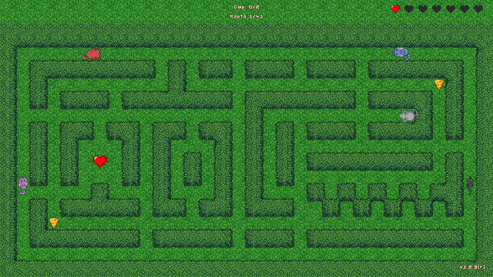

# CATS AND MOUSES («Кошки-мышки»)

2D-аркада-лабиринт в духе **Pac-Man** с инверсией ролей: игрок ведёт **мышь**, которая собирает сыр,
а по коридорам за ней охотятся **четыре кота** с разными характерами. Цель уровня — собрать весь сыр,
не попавшись. Офлайн, без рекламы и покупок; русский и английский языки.




## 📦 Скачать

Игра в **RuStore**: https://www.rustore.ru/catalog/app/com.catsandmouses

Про то, как эта игра делалась вместе с ИИ-агентом (ни строчки кода руками) — девлог в
[`blog/ai-devlog/ARTICLE.md`](blog/ai-devlog/ARTICLE.md).

## ⚙️ Технический стек

- **Язык**: Kotlin 1.9.24
- **Движок**: LibGDX 1.12.1
- **Платформы**: Android (minSdk 24, targetSdk 35) + Desktop (LWJGL3)
- **Сборка**: Gradle 8.9, Kotlin DSL, JDK 21

## 🐭 Как играть

- **Мышь** двигается строго по сетке, поворот — только в центре клетки.
- **Цель** — собрать весь сыр на карте; после этого уровень пройден и начинается следующий.
- **Жизни**: стартовый запас копится; **сердечки** на карте дают +1 жизнь (до 7). При поимке жизнь
  тратится, мышь переносится в дальнюю от котов часть лабиринта и на 1,5 с становится неуязвимой.
- **Коты** (опасность):

| Кот | Характер |
|-----|----------|
| **Барсик** (Hunter / Chaser) | идёт к мыши кратчайшим путём (BFS) |
| **Матроскин** (Prowler / Patrol) | патрулирует коридоры |
| **Леопольд** (Ziggy / Random) | блуждает случайно |
| **Черныш** (Shadow / Ambush) | поджидает в засаде / перехватывает |

- **Контент**: 8 миров × 5 карт + финальная карта = **41 уровень**; у каждого мира своя тема
  (трава, замок, лёд, песок, мох, болото, вулкан, кухня; финал — космос).
- **Финал** с подвохом: проходится, только если мышь **не сдвинулась** с места.
- **Звук**: музыка (заставка/меню/игра) и SFX; ползунки громкости — в «Настройках».

### Управление

| Платформа | Управление |
|-----------|------------|
| **Desktop** | `W`/`S`/`A`/`D` или стрелки; **Space** — пауза |
| **Android** | свайпы в нужную сторону (порог 40 px); тап — старт |

### Отладка (Desktop)

- `--debug` — включить логи LibGDX.
- `--ai-mode [PORT]` — AI-режим: встроенный HTTP-сервер (`GET /state`, `POST /input`).
- MCP-сервер для управления игрой из ИИ-агента — в [`mcp-server/`](mcp-server/).

## 🚀 Запуск

### Desktop
```powershell
.\gradlew lwjgl3:run
```

### Android
```powershell
.\gradlew android:installDebug
```
Требуется подключённое устройство или эмулятор.

### Полная сборка
```powershell
.\gradlew build
```

> При ошибке кэша Gradle (`Could not read workspace metadata`) — удали содержимое `%USERPROFILE%\.gradle\caches\8.9\transforms` и собери с `.\gradlew build --no-daemon`.

## 📁 Структура

```
core/        Игровая логика (MainGame, GameScreen, GameWorld, MazeLoader, entities/, graphics/, i18n/, audio/)
android/     Android-модуль (adb: иконка, mipmap, локали)
lwjgl3/      Desktop-модуль (+ редактор карт --editor)
mcp-server/  MCP-сервер для управления игрой из ИИ-агента (Python/FastMCP)
assets/      Ресурсы:
  maps/       Карты лабиринта (<мир>/<карта>.txt, theme.json) + maps.json
  themes/     Темы локаций (9 тем: grass, castle, ice, desert, moss, swamp, space, volcano, kitchen)
  sprites/    Спрайты персонажей (мышь, сыр, сердечки, 4 кота)
  text/       Титры (credits_ru/en.txt)
  me/         Фото пасхалки после титров
blog/ai-devlog/  Девлог о разработке (статья + иллюстрации)
store/       Материалы для магазинов (RuStore, блог)
tests/       Dev-анализ карт (Python, вне сборки)
tools/       Dev-скрипты
```

## 🗺️ Изменение карты

Карты лежат в `assets/maps/` (**32 колонки × 16 строк**). Редактор — `.\gradlew lwjgl3:runEditor`.

| Символ | Значение |
|--------|----------|
| `#` | стена |
| пробел | проход |
| `1`–`9` | сыр (сколько цифр — столько сыров) |
| `H` | сердечко (+1 жизнь, до 3 на карту) |
| `^` `v` `<` `>` | старт мыши с направлением взгляда (`+` — старый эквивалент `^`) |
| `A`–`D` | старты котов (иначе — 4 случайных у углов) |

## 🎨 Темы локаций

Тема определяет фон и стены (`assets/themes/<тема>/theme.json`). Активная — в `assets/themes/themes.json`.
Доступно **9 тем**: `grass`, `castle`, `ice`, `desert`, `moss`, `swamp`, `space`, `volcano`, `kitchen`.

## 📄 Лицензия

[MIT](LICENSE). Идея — Андрей и Екатерина Голубевы. Код, тексты и часть ассетов созданы в паре
с ИИ-агентами (DeepSeek 4.1 Flash, Kimi 2.7 Code, BigPickle); графика — SpriteCook; музыка/звуки — CC0
(Juhani Junkala, Kenney).

Подробное описание проекта — в [GAME.md](GAME.md); история — [CHANGELOG.md](CHANGELOG.md);
навигация по меню — [MENU.md](MENU.md); звук — [MUSIC.md](MUSIC.md); запуск — [RUN.md](RUN.md);
правила для ИИ-агента — [AGENTS.md](AGENTS.md).
