# Я не написал ни строчки кода — и игра вышла в RuStore

*Как я месяц разговаривал с ИИ, забыв про работу, как дочка подкинула идею, а в конце в магазине появилась игра
«Кошки-мышки». Дисклеймер: эту статью тоже написал не я — её сгенерировал AI (модель
**DeepSeek 4.1 Flash**). Над статьёй мы работали вдвоём — я и AI: много планировали, дополняли и
редактировали её, — но ровно так же, как игру: только через промпты и общение. Я лишь писал
промпты и нажимал «отправить».*

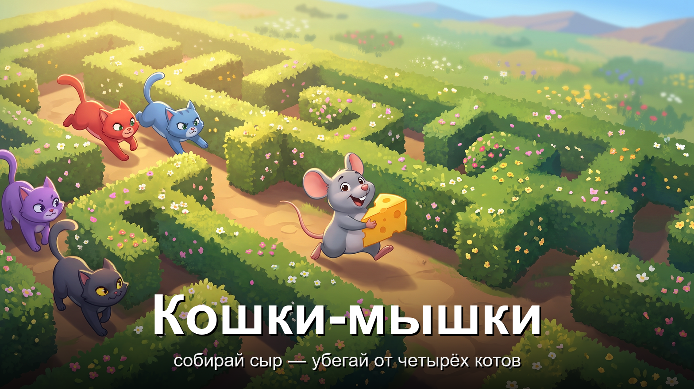

Я программист с приличным стажем — начал ещё тогда, когда об ИИ даже не думали: писал на
больших советских ЭВМ **ЕС-1033** и **ЕС-1045**. И примерно так же давно я откладывал знакомство
с ИИ-агентами: «ну, поболтать умеет, но код-то всё равно писать мне». Спорить было не о чем —
до тех пор, пока идею не озвучила дочка. Коты — вообще моя слабость: дома у нас живут две
кошечки, а на даче по утрам они приносят нам мышек. Идея буквально витала в воздухе — и за
ужином дочка сказала: «Пап, а сделай игру, где мышка убегает от котов».
Обычно на такое отвечаешь «да-да, потом». Я ответил иначе и поставил себе условие:
**я не напишу ни строчки кода**. Совсем. Ни одной. Если ИИ такой умный — пусть докажет.
А если вдруг не выйдет — так и быть, объявлю, что это был «эксперимент».

И сразу про финиш: это не «демка на выходных» и не игра на флешке для друзей, а **публикация
в RuStore**. Разница принципиальная: магазин принимает только по **жёстким требованиям** —
сборка не должна падать, нужны иконка, скриншоты, описание, возрастной рейтинг, всё проходит
модерацию. Именно эти требования не дают остановиться на середине и беспощадно вычищают
«почти готово».

Месяц спустя в магазине приложений и игр RuStore лежит «Кошки-мышки»: 41 уровень, восемь миров и финальная карта,
где по коридорам за мышью гоняются четыре кота. А я за весь проект ни разу не открыл редактор кода.
Об этом и расскажу — по-честному и с цифрами.

## Правила игры: что считалось «написать код»

Сразу договоримся: «ни строчки кода» — это не про «слегка подсобил». Всё, что попало в проект —
логика, экраны, настройки, подпись приложения, — сделано **через обычные текстовые запросы
(промпты) к агенту**. Промпт — это просто просьба словами: «сделай так, чтобы сердечко пульсировало».

Руками я делал ровно одно — **заполнял веб-формы там, где нет программного интерфейса**.
Например, вбивал текст на сайт проверки уникальности и нажимал «Отправить» в консоли RuStore.
Программировать вручную — ни разу. Честно? Честно. Пальцами я набирал только пароли — и то
потому, что агенту знать их необязательно.

> **Для не-технарей:** представьте, что вместо работы руками вы весь месяц диктуете задачу
> очень исполнительному, но буквальному стажёру. Он не устаёт, не спорит и помнит всё, что вы
> записали. Но если объяснить криво — сделает ровно так, как криво объяснили.

## Кто такой «ИИ-агент» и как мы работали

Я использовал инструмент, который запускает ИИ прямо у меня на компьютере: видит файлы
проекта, может их менять, запускать сборку и тесты, искать по репозиторию и выполнять команды.
Это важно: это не «чат, который пишет куски текста», а **агент**, который сам делает шаги.

Одной моделью дело не обошлось: за проект их сменилось несколько — **DeepSeek 4.1 Flash**,
**Kimi 2.7 Code** и **BigPickle**. Дальше буду называть их всех просто **AI** (или «агент») —
чтобы не путаться.

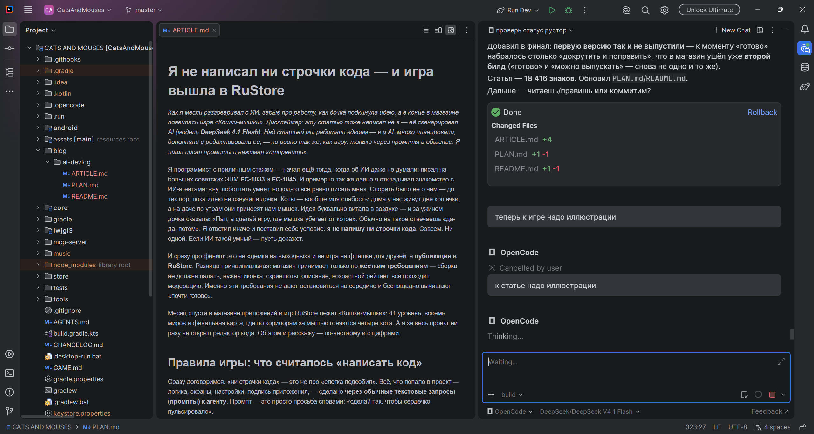

Мой вклад — продуктовые решения и приёмка: что делаем, что важнее, что годится, а что переделать.
По сути я из программиста превратился в заказчика, который весь день пишет ТЗ и повторяет
«нет, не так».
Вклад агента — почти весь рутинный труд: код, документы, тесты, сборки. Роли примерно такие:

| Я (человек) | Агент |
|---|---|
| Что и зачем делаем, приоритеты | Пишет код и тексты |
| Приёмка: «годится» / «переделай» | Ищет по проекту, предлагает варианты |
| Решения о деньгах и публикации | Гоняет сборки, тесты, рутину |

## Главный секрет: память проекта

Оказалось, самое важное в работе с агентом — не «умный промпт», а **документы**. У проекта
появилась настоящая память:

- **описание игры** — что это вообще за игра;
- **план** — что делаем сейчас и что дальше;
- **меню** — какой экран куда ведёт (источник истины: сначала правим документ, потом код);
- **журнал изменений** — что менялось от версии к версии.

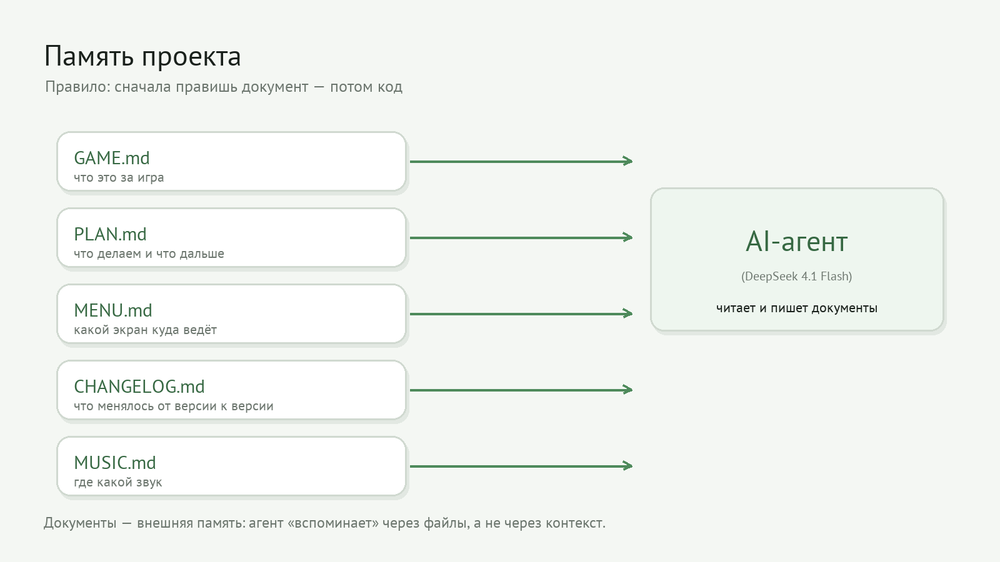

Правило было жёстким: **сначала правь документ, потом код**. Это спасает от самой дорогой
болезни агентов — «уплывания контекста». Когда долго беседуешь, агент рано или поздно
забывает, о чём вы говорили. Однажды агент забыл, и я спросил: «ты потерял контекст?».
Знакомая ситуация — просто держите факты в файлах, а не в голове.

И отдельное правило: **журнал изменений вести обязательно** — лучше через отдельный «навык»
агента, чтобы он писал его сам. Когда сессия теряется (а она теряется), журнал становится точкой
возврата: открываешь — и видно, что уже сделано и что дальше. Экономит массу времени.

И так — **под каждую задачу**: свой кусочек плана, обязательная запись, проработка и **отметки
выполнения** (галочки). Большая цель «сделать игру» разбивается на этапы, у каждого — понятное
«готово». Так прогресс видно всегда — и мне, и агенту.

> **Для не-технарей:** это как рабочая тетрадь смены. Неважно, кто пришёл в следующую смену —
> свежий сотрудник или тот же человек с утра, — он открывает тетрадь и видит, где остановились.

## Навыки: научил один раз — работает всегда

Второе открытие — **навыки**. Это заготовленные инструкции для повторяющихся дел: «как
запускать игру», «как публиковать в RuStore», «как сгенерировать новую тему локации»,
«как коммитить и пушить». Я один раз описал процедуру — и дальше агент повторял её сам,
не изобретая велосипед.

Получилась эдакая «инструкция по технике безопасности», только для ИИ: не импровизируй,
делай по шагам. Список навыков в проекте перевалил за десяток — от игровых до магазинных.
Мой любимый — «git-workflow»: я больше не придумываю сообщения к коммитам, а просто говорю
«сохрани».

## Инструменты наружу: где агент дотягивается до мира

Агент умеет подключаться к внешним сервисам — так называемые **MCP-инструменты**. У нас их три:

1. **Генерация картинок** — я не рисовал ни одного спрайта. Мышь, коты, сыр, восемь тем
   локаций (трава, замок, лёд, песок, мох, болото, вулкан и гигантская кухня) — всё
   сгенерировано по текстовому описанию, как «нарисуй пиксельного кота-охотника».
   Картинки тоже делали разные модели — в основном `gemini-3-pro-image`, `gemini-3.1-flash-image`
   и `gpt-image-2.5-flare` (через сервис SpriteCook). И с первого раза выходило редко: картинки
   **приходилось перегенерировать** — то лапы не такие, то цвет мимо. Хорошая картинка — обычно
   результат нескольких попыток.
2. **Проверка балансов** — я следил за расходом кредитов генератора, как за счётчиком на такси.
3. **Управление самой игрой.** Тут мы пошли дальше: написали **собственный MCP-сервер** —
   мостик между запущенной игрой и AI. Агент умеет подключиться, посмотреть состояние игры и
   **сам в неё «поиграть»**: двигать мышь вверх-вниз-влево-вправо, ставить паузу, перезапускать
   уровень. Получается эдакий автотестер, который прокатывает разные сценарии и докладывает,
   что сломалось. Так AI проверял результат сам — без меня за клавиатурой.

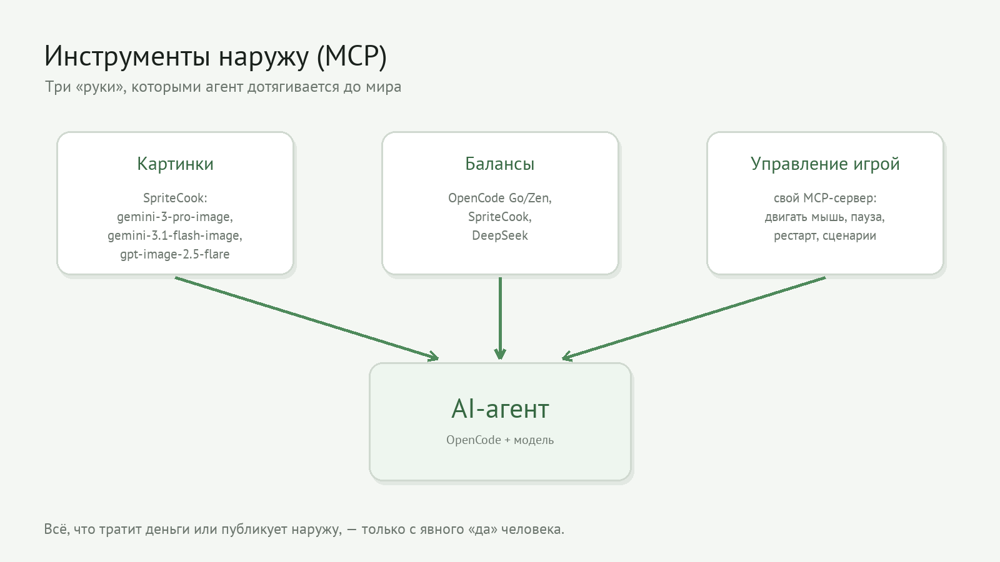

Было и важное правило безопасности: **всё, что тратит деньги или публикует наружу, — только
с моего явного «да»**. Агент не имеет права сам решать «давай протестируем ещё десять картинок».

## Как это выглядело на одной задаче

Любая фича шла одним и тем же маршрутом. Возьмём сердечки-бонусы:

1. Я ставлю задачу словами: «хочу сердечки на карте, дают дополнительную жизнь».
2. Агент правит документы (план, описание, меню) — как и договаривались, сначала бумаги.
3. Пишет код и **автотесты** — маленькие программы-проверки, которые следят, что старое не сломалось.
4. Гоняет сборку и тесты, показывает отчёт; я запускаю игру и придираюсь.
5. «Годится» — коммитим и едем дальше.

Тестов к финалу накопилось около двухсот пятидесяти. Для меня, как для программиста, это
был момент личной гордости: я не написал их сам, но именно они давали уверенность, что агент
не развалил проект по дороге.

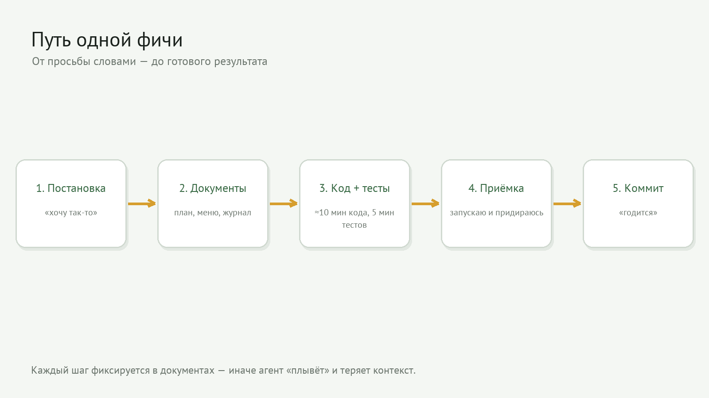

## Как игра росла: от одного кота к четырём

Никто не рождается с готовой большой игрой — она росла итерациями, как снежный ком. И это,
пожалуй, самое ценное в таком подходе:

- **Самый первый прототип:** одна мышка просто бегает по лабиринту — никаких котов. И стены тогда
  были не красивые (15 разных тайлов пришли сильно позже), а всего два спрайта: пол и стена.
- **Затем появился кот** — один, который гоняется за мышью. Просто, но уже играется.
- **Потом котов стало три**, а затем **четыре** — и у каждого свой характер погони.
- **Финишный этап:** появились **сердечки-жизни**. Снова с подачи дочки — «пусть у мышки будут
  жизни!». Заодно докручивали сложность и оформление.

Главный принцип: каждая версия была **рабочей**. Не «полгода делаем, потом покажем», а по
чуть-чуть, но живое и проверенное на каждом шаге. Поэтому в конце получилась не груда кода,
а игра, в которую уже играют.

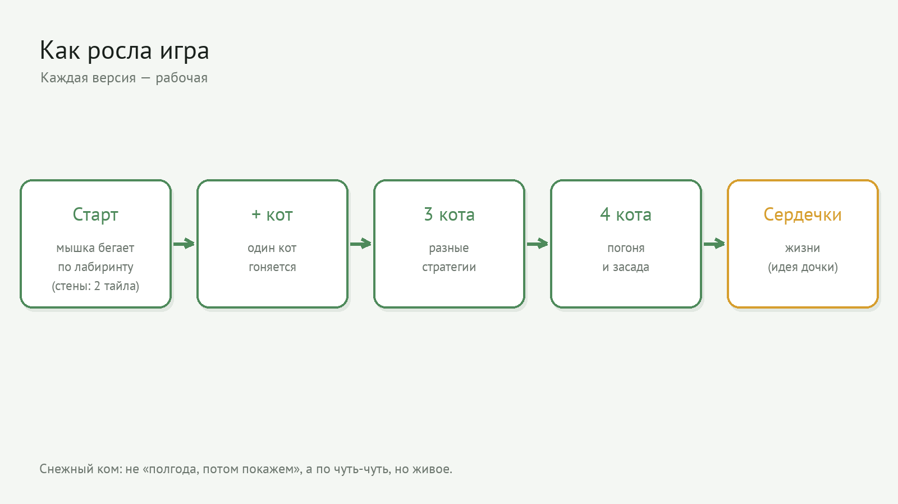

## Лабиринты: где пришлось всё взять в руки

Была сфера, где агент так и не вытянул. **Лабиринты.** Генерировать их агент умел, но чётко
сформулировать правила «какие карты мне нравятся» у меня так и не получилось. На словах это
звучало как «ну, чтобы было интересно и не слишком пусто» — а это, как мы уже выяснили, не
техзадание, а пожелание.

В итоге **все карты я докручивал вручную**, а **финишную карту вообще нарисовал сам**, клетка за
клеткой. Важный нюанс: это не код, а дизайн уровня, — условие «ни строчки кода» не нарушено.
Просто честно: не всё стоит доверять формулировкам, иногда быстрее сделать руками.

А чтобы делать это было удобно, на одном из этапов мы собрали **редактор карт** — отдельную
программу, где лабиринт рисуется мышкой: стены, сыр, сердечки, старты котов. Щёлкнул по клетке —
она изменилась; нажал кнопку — карта сохранилась и тут же появилась в игре. Так что «ручной
режим» получился не мучением, а нормальным инструментом.

> **Для не-технарей:** это как умный генератор текстов: абзацы пишет отлично, но «фирменный
> стиль» компании не угадывает. Проще дописать самому, чем объяснять, чего душа хочет.

## Часы на план, минуты на код

Самое неочевидное открытие: **больше всего времени уходило на план**, а не на код. Прежде чем
что-то делать, мы кропотливо и тщательно прорабатывали задачу — **несколько часов** на то, чтобы
разложить фичу по шагам, договориться о поведении и записать всё в документы.

А потом — почти по щелчку: **10 минут генерации кода и 5 минут тестов**. И не потому, что код
«простой», а потому что к моменту генерации уже не осталось вопросов. Вся тяжёлая работа была
сделана заранее — на бумаге.

Отсюда вывод: скорость агента бесполезна без качества плана. Хорошее ТЗ — это когда код почти
пишется сам. Плохое — когда агент бодро генерирует не то, а вы наматываете круги.

Отдельно отмечу приём, который понравился больше всего: дать AI свежий взгляд и сказать —
«посмотри **финальный план** и **задай вопросы, которые вызывают сомнение или подозрение**».
Агент начинал придираться к собственному плану: находил дыры, противоречия и «а что, если…».
Пара таких вопросов экономила часы переделок — и всплывало то, о чём я сам не подумал.

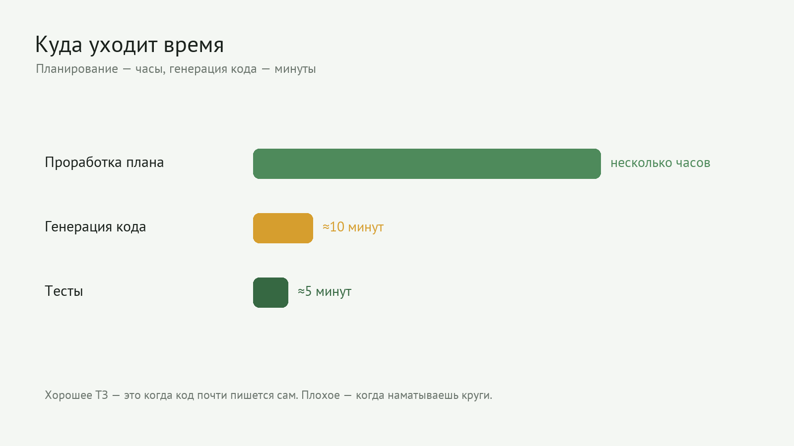

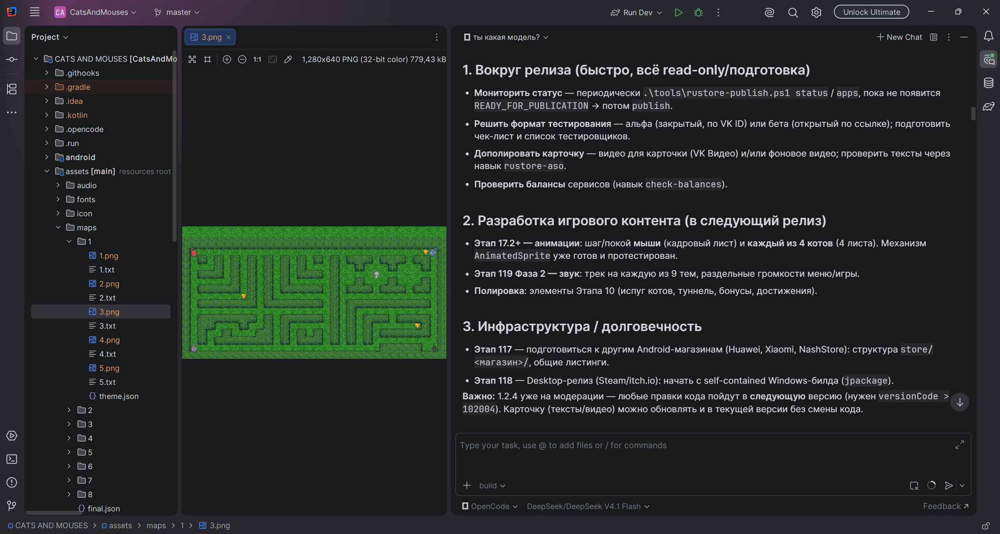

> **Для не-технарей:** это как ужин. Час уходит на меню и закупку продуктов — а потом 15 минут
> на готовку. «Готовка за 15 минут» — следствие того часа, а не его отсутствия.

## Я учился разговаривать с ИИ

Честно: первый месяц я не столько программировал, сколько **учился общаться**. Я обращался с
агентом как с коллегой, который «и так поймёт», — и ошибался в промптах раз за разом.
Главная моя ошибка — **переоценить догадливость агента**. Я писал «сделай красиво», «ну ты понял»,
«как в прошлый раз» — и получал буквально «как в прошлый раз», а не то, что было у меня в голове.
Агент не читает мысли и не додумывает за вас — просто исполняет ровно ту задачу, которую
вы сформулировали, включая всю её кривизну.

Правила, которые я вывел кровью и переделками:

- пишите **что** и **зачем**, а не «сделай хорошо»;
- дробите большую просьбу на маленькие шаги;
- если нужен конкретный вид — покажите пример;
- проверяйте результат сразу, а не через десять задач.

Промпт — это не заклинание, а **техзадание**. Чем оно точнее, тем меньше кругов «нет, не так».

И классическое «пишите хорошо и не пишите плохо» тут **не работает вообще**. У агента нет вашего
«хорошо» в голове — есть только то, что вы записали. Не сформулировал — не угадает.

> **Для не-технарей:** ровно то же самое, что с людьми. «Сделай нормально» — это не задание,
> а пожелание. Задание — это «сделай таблицу, где сверху месяцы, а слева статьи расходов».

## Цифры

Терпеть не могу посты «ИИ — это будущее» без конкретики. Поэтому вот факты:

| Показатель | Значение |
|---|---|
| Календарно | ~5 недель |
| Часов (оценка) | ~75–95, в основном вечерами после работы |
| Коммитов (сохранённых изменений) | 112 |
| Версий по журналу | 75 |
| Кода | 82 файла, ~6 300 строк |
| Автотестов | ~250 |
| Контент | 8 миров + финал = **41 уровень**, 9 тем |
| Строк кода, написанных мной | **0** |

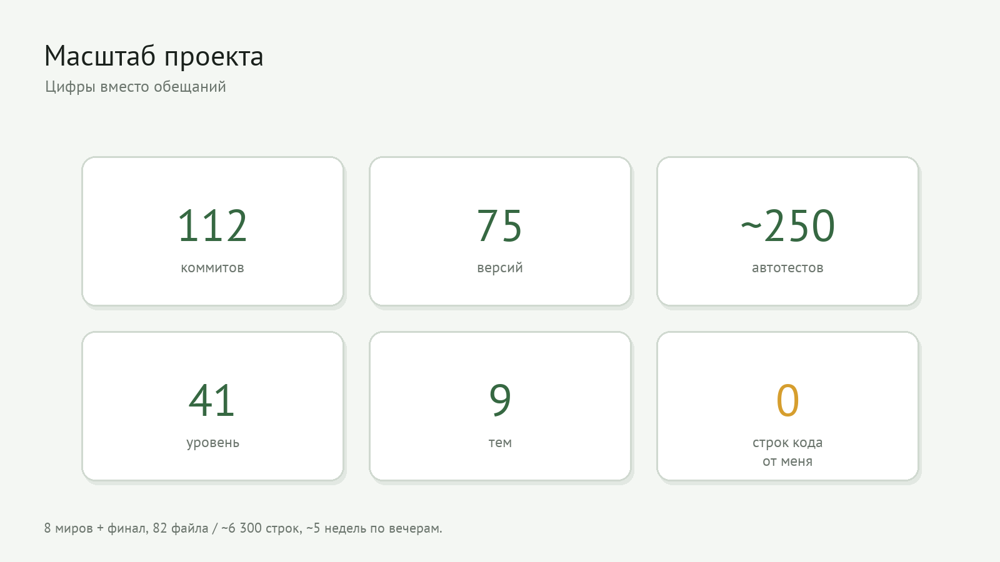

Темп был разным: первую неделю — 3–5 часов в день (затянуло), потом 2–3, под конец 1–2 часа.
По выходным чуть больше. В сумме — как один напряжённый месяц по вечерам. А на финише — ещё
две ночи по 4–5 часов: шла предподготовка к публикации. Так что если кто-то говорит «за два
часа» — пусть попробует при мне.

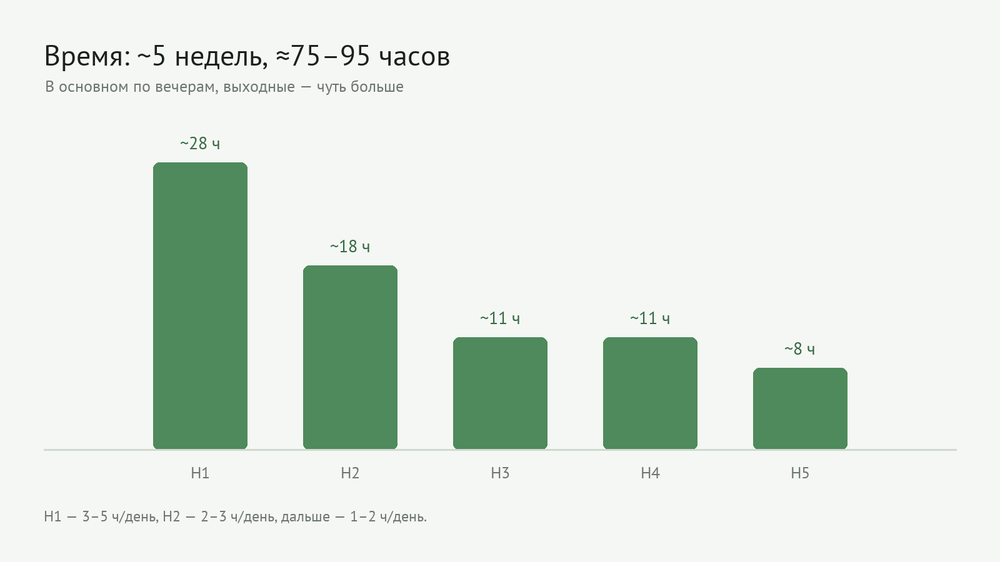

## Миф «ИИ за два часа написал Геншин»

Сейчас интернет завален роликами: блогер садится за компьютер, и за два часа ИИ-агент «пишет
Геншин», всё запускается, зал аплодирует. Мой опыт говорит **ровно обратное**.

Каркас игры — мышь, коты, лабиринт, сбор сыра — агент действительно собрал **за три дня**.
Быстро. Но между «игра запускается» и «игру можно опубликовать» лежит пропасть.

Всё остальное время ушло **не на «написать игру»**, а на то, о чём в роликах стыдливо молчат:
оболочка и меню, программы и окружение (инструменты, среда разработки, сборка, подпись
приложения, магазин), бесконечный **допил функционала** и **наведение красоты** — звук,
анимации, баланс сложности, тексты, локализация.

Если честно: из месяца работы «написать игру» — это три дня, а остальное — довести её до
состояния, за которое не стыдно показать людям. Такие ролики показывают первую минуту
фейерверка и аккуратно вырезают оставшиеся полтора часа.

> **Для не-технарей:** это как ремонт. Стены возвести — быстро. А потом месяцами: розетки,
> плинтусы, плитка, мебель, чтобы в итоге было «просто красиво». Вот «красиво» и съедает время.

## Деньги

Все счета я открывал «с нуля», поэтому цифры честные, а не «у меня уже был оплаченный тариф»:

| Статья | Сколько |
|---|---|
| Оплата моделей ИИ | **≈ $60** |
| Генерация картинок (кредиты) | **≈ $16** |
| Остатки на счетах | **≈ $70** |

Проще говоря: **деньгами я почти ничего не потратил**, а неизрасходованный остаток ещё и даёт
приятное чувство свободы. Основные расходы — модели и генерация картинок. Для сравнения:
заказать хотя бы часть этих спрайтов у художника стоило бы заметно больше — и дольше. А заказать
разработку целой игры — там счёт пошёл бы на совсем другие цифры (и месяцы, и нервы).

## Что пошло не так

Если вам кажется, что это была гладкая история, — нет.

- **Агент терял контекст.** «Ты потерял контекст?» — вопрос, который я задавал не раз.
  Лечится тетрадью (см. выше).
- **Сборка ломалась на ровном месте.** Иногда портился кэш — и проект «вдруг» переставал
  собираться, хотя никто ничего не трогал. Приходилось чистить и перезапускать.
- **Эксперимент, который всё испортил.** Решили положить спрайты на «холст» побольше —
  и на экране всё стало крошечным. Откатили за пару минут, но вывод усвоили: агент делает
  ровно то, что просишь, — включая глупости.
- **Переделки.** Формулируешь размыто — получаешь не то. Чем точнее задача, тем меньше циклов
  «нет, не так». Навык писать нормальные ТЗ прокачался лучше всего.
- **Картинки — не с первого раза.** Генератор не волшебник: вместо кота мог выйти «кот» со
  странными лапами, а тема локации — не в том цвете. Иногда перерисовывали по нескольку раз.
  Каждая перегенерация — это снова кредиты, поэтому «сначала уточнить, потом генерировать»
  выходит дешевле, чем гадать.
- **Переоценил догадливость.** Я думал, что агент «сам поймёт», а агент честно понимал
  буквально. Половина переделок в проекте — из-за моих же невнятных формулировок, а вовсе не
  из-за глупости агента.
- **Анекдот напоследок.** Когда мы готовили статью в блог самого RuStore, агент честно
  предупредил: «эти скриншоты дублируют те, что магазин добавит сам, — их присылать не нужно».
  Полезно, но смешно: критиковать мою же работу пришлось машине.

А если вам расскажут, что всё прошло гладко и с первого раза, — не верьте: гладко бывает
только в чужих роликах.

## Что в итоге

Игра **«Кошки-мышки»** опубликована в RuStore: вы ведёте мышь, собираете сыр и уходите от
четырёх котов с разными характерами — один гонится, второй патрулирует, третий бегает
случайно, четвёртый ждёт в засаде. 41 уровень, восемь миров, **музыка и звуки** (музыка на
заставке, в меню и в игре, отдельные звуки на каждый сбор сыра и сердечка; громкость музыки и
звуков регулируется в «Настройках»), работа без интернета, без рекламы и покупок.

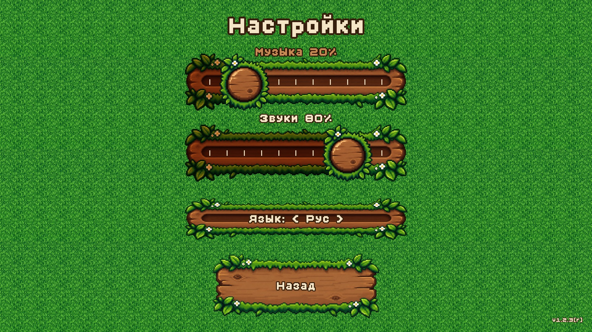

Кстати, **первую версию мы так и не выпустили**. К моменту, когда она была «готова», набралось
столько «докрутить и поправить», что в магазин ушёл уже **второй билд**. Классика: «готово» и
«можно выпускать» — снова не одно и то же.

Дополнительно мы отправили в блог RuStore большой обзор игры, а исходники выложили на GitHub
под свободной лицензией MIT — любой может почитать код и убедиться: **его писал не я**.

И да — эту статью тоже написал AI (тот самый DeepSeek 4.1 Flash), а «допиливали» и «наводили
красоту» мы её ровно тем же способом, что и игру: через промпты и разговор, без единой строки,
набранной мной вручную. Я лишь сказал: «сделай смешно и честно».

## Мой чек-лист, если хотите повторить

1. **Поставьте жёсткое условие.** «Я не пишу код» отлично тренирует точность формулировок.
2. **Заведите документацию проекта: PLAN.md, GAME.md, MENU.md.** Документы важнее промптов: описание, план, журнал.
3. **Напишите правила игры.** Что агенту можно, что нельзя, что без вашего «да» — нельзя.
4. **Автоматизируйте проверки.** Тесты — ваша страховка от «сделал, но сломал».
5. **Готовьтесь к буквализму.** Просишь красиво — получишь буквально. Просишь точно — получишь результат.
6. **Ведите журнал изменений (CHANGELOG) — обязательно, и через навык агента.** Это ваша точка
   возврата при потере сессии: что сделано, что дальше. Экономит массу времени.
7. **Начните с малого и доведите до конца.** «Вышло в магазин» — совсем другой опыт, чем «поигрался вечерок».

Месяц назад я сомневался, что из этого выйдет что-то серьёзное. Сегодня в телефоне у дочки
есть игра, которую «сделал папа». Формально — папа. Фактически — папа и один очень усидчивый ИИ.

---

*P.S. Если вам показалось, что эту статью писал живой человек с чувством юмора, — спасибо за
комплимент. Но нет: это был AI. Правда, с очень хорошим ТЗ.*